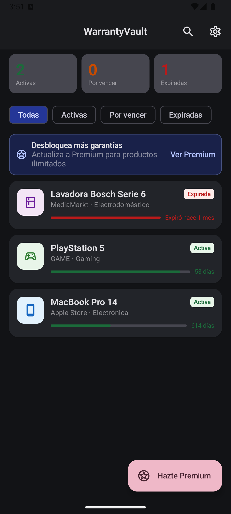
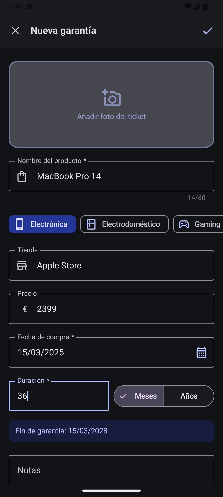
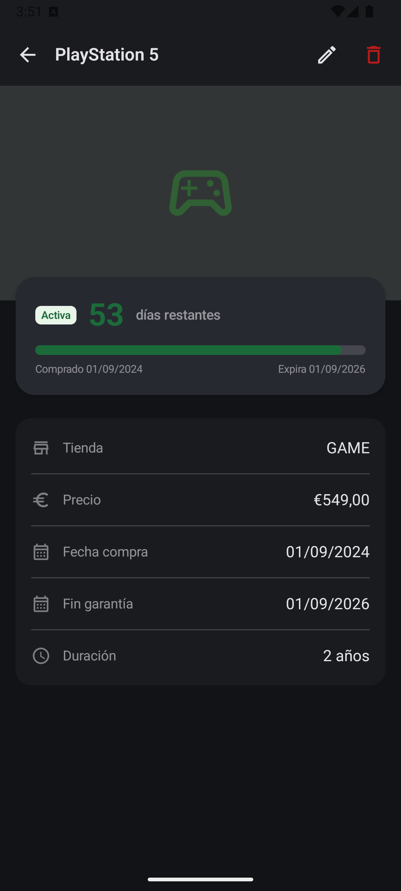
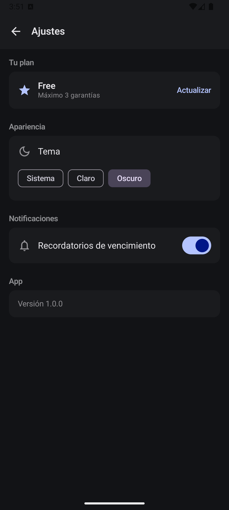

# WarrantyVault

Android app to keep every product warranty and receipt in one place and get reminded before it expires.

<p>
  
  
  
  
</p>

## Features

- Store products with purchase date, store, price, category and warranty length (months or years).
- Attach a photo of the receipt, copied off the main thread so cloud-only images don't freeze the UI.
- Expiry reminders 30, 14, 7 and 1 day before the end date, scheduled with WorkManager.
- Status at a glance: active, expiring soon and expired, with progress and days remaining.
- Search, category filters and summary stats.
- Light, dark or system theme. Spanish and English.
- Fully offline: data never leaves the device.
- Free plan with 3 warranties, Premium subscription through Google Play Billing.

## Tech stack

| Area | Choice |
|---|---|
| Language | Kotlin |
| UI | Jetpack Compose, Material 3, Navigation Compose |
| Architecture | Clean Architecture, MVVM, multi-module |
| Async | Coroutines, Flow, StateFlow |
| Persistence | Room, DataStore |
| Background work | WorkManager |
| DI | Koin |
| Billing | Google Play Billing 7 |
| Analytics | `AnalyticsTracker` interface with a Firebase implementation (no-op until configured) |
| Testing | JUnit, MockK, Turbine, kotlinx-coroutines-test |

## Modules

```
:app                  composition root: MainActivity, navigation, DI, billing, notifications
:feature:home         list, search, filters, stats
:feature:addedit      add / edit form with process-death-safe draft
:feature:detail       warranty detail and delete
:feature:premium      paywall
:feature:settings     theme, notifications, plan
:feature:onboarding   first run
:core:domain          models, use cases, repository contracts (pure Kotlin)
:core:database        Room, DataStore, repository implementations
:core:ui              theme and shared composables
```

Features depend only on `:core:domain` and `:core:ui`, never on each other or on the database layer.

## Notable details

- **Locale-aware price parsing.** Spanish users type `1.299,99`, English users `1,299.99`. Both parse to the same value, and the edit screen writes the price back in a format guaranteed to round-trip.
- **Month-end durations.** `31 Jan + 1 month = 28 Feb`. The edit screen rebuilds the duration the user originally typed instead of the shorter calendar distance.
- **Process death.** The add / edit form is backed by `SavedStateHandle`, so picking a photo on a low-memory phone doesn't wipe it.
- **Resilient preferences.** A corrupted DataStore file is replaced instead of crashing the app on every launch.
- **Billing.** Purchases are acknowledged, pending purchases handled, and premium is revalidated every time the app returns to the foreground.

## Build

```bash
./gradlew assembleDebug   # debug APK
./gradlew test            # unit tests
```

Release signing reads `KEYSTORE_PATH`, `KEYSTORE_PASSWORD`, `KEY_ALIAS` and `KEY_PASSWORD` from the environment.

## License

Copyright (c) 2026 Miguel Angel Mialdea Monzo. All rights reserved. The source is published for portfolio purposes only; no license is granted to copy, modify or redistribute it.
